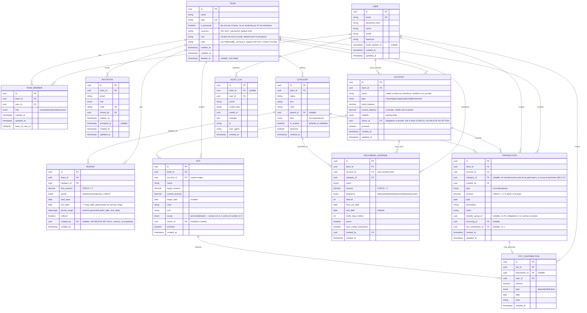

**Nota de versión 2.15:** sesión del 26 oct (TRD v2.20). Resuelto el
pendiente de esquema de la v2.14: `categories.archived` ya existía (migración
del 23 sep, no figuraba en el repaso) y `categories.kind` gana el `CHECK`
`categories_kind_valid` (§4.4.3). Los errores de BD se traducen a 422
(§4.4.3, implementado salvo `23503`).

**Nota de versión 2.14:** sesión del 23 oct, categorías (PRD v2.9):
nueva regla §4.3.19. Las categorías del sistema solo se archivan (nunca
se editan ni eliminan); las normales se eliminan solo sin registros
asociados. **Pendiente de esquema:** `categories.archived` está en el
diagrama pero **no existe en la migración**, y `categories.kind` es
`string` en vez de `enum()`; ambos se corrigen antes del CRUD de
categorías.

**Nota de versión 2.13:** sesión del 23 oct, ciclo de vida de cuentas y
usuarios (PRD v2.8):

1. **Eliminar cuentas (§4.3.18, nueva):** solo si la cuenta no tiene
   transacciones ni gastos recurrentes; si los tiene, se archiva. Dos
   capas: la action responde 422 y las FKs `transactions.account_id` y
   `recurring_expenses.account_id` ya son `RESTRICT`.
2. **Miembro que sale o es removido (§4.3.8):** sus cuentas privadas en
   ese team se archivan automáticamente y conservan `owner_id`.
3. **Borrado de usuarios (§4.3.9):** se anonimiza la fila de `users` en
   vez de borrarla; resuelve el "flujo pendiente" de la v2.8 (la FK
   `accounts.owner_id` con `NO ACTION` nunca llega a dispararse).
4. **Permisos de cuentas (§4.3.8):** el nombre de toda cuenta lo ve
   cualquier miembro; editar, archivar o eliminar una cuenta privada solo
   lo puede su dueño, ni siquiera el owner del team.
5. **API §5.4:** `DELETE /accounts/{id}`.

**Nota de versión 2.12:** sesión del 20 oct (TRD v2.18): la
reconciliación **detecta y reporta, no corrige** (§4.5). La corrección de
saldos es un paso explícito (`nestly:reconcile --fix`). El saldo esperado
se recalcula en SQL, independiente del código de las actions.

**Nota de versión 2.11:** sesiones del 16 y 19 oct, edición de
transferencias (TRD v2.17):

1. **Regla §4.3.15 precisada (editar):** editar una transferencia
   modifica sus dos filas existentes; no cambian `transfer_group_id` ni
   `created_by`. El permiso del caso A se evalúa contra las cuentas
   **originales** de la transferencia, no contra las nuevas: así un
   member no gana permiso moviéndola a su propia cuenta privada.
2. **Regla §4.3.17 precisada:** al editar, la categoría se recalcula con
   los datos nuevos; si la transferencia deja de cruzar el perímetro
   (pasa a team → team), la categoría se limpia.
3. **API §5.4:** nuevo `PATCH /transfers/{transferGroupId}`.

**Nota de versión 2.10:** sesión del 14 oct, transferencias entre cuentas
privadas:

1. **Regla §4.3.15 ampliada (privada → privada prohibida):** una cuenta
   privada solo mueve dinero a través del perímetro del team (team →
   privada o privada → team). Una transferencia entre dos cuentas
   `private` no toca dinero del team, así que se rechaza con 422 en
   `to_account_id`, incluso si las dos son del mismo dueño. Aplica en
   cualquier team. Si además el origen es una privada ajena, gana el 403
   (se evalúa antes).
2. **Regla §4.3.17 confirmada:** la categoría solo se admite en team →
   privada y privada → team; team → team con categoría sigue siendo 422.
   Con privada → privada prohibida, toda transferencia es team → team
   (sin categoría) o cruza el perímetro (categoría opcional).
3. **API §5.4:** `POST /transfers` documenta el 422 de privada → privada.
4. **Regla §4.3.8 ampliada (sin cuentas privadas en el team personal):**
   un team con `is_personal = true` no admite cuentas `private` (422 al
   crearlas). Ahí todas las cuentas son `team`: el team entero ya es lo
   privado del usuario, y una cuenta privada solo admitiría
   transferencias, así que no podría registrar sus propios gastos.
   Pendiente de implementar con la action de crear cuentas.
5. **Regla §4.3.17 implementada** (categoría en transferencias): 404 →
   perímetro → `kind`, guardada solo en la pata `team`.

**Nota de versión 2.9:** sesión del 12 oct, transferencias y KPIs (PRD
v2.7):

1. **Regla §4.3.15 ampliada (editar y borrar):** pueden editar o borrar
   una transferencia su creador, el dueño de una cuenta privada
   involucrada o un admin+, todos con rol al menos member. Al editar,
   los datos nuevos pasan por las reglas de creación. No se agrega
   `updated_by`: la trazabilidad de ediciones la da `AUDIT_LOG`.
2. **Perímetro del team en los KPIs (regla §4.3.3):** el perímetro son
   las cuentas `team`. Team → team no es ingreso ni gasto; team →
   privada es gasto; privada → team es ingreso. Reemplaza la regla
   anterior ("los KPIs excluyen toda fila con `transfer_group_id`"), que
   hacía bajar el balance sin que apareciera ningún gasto.
3. **Nueva regla §4.3.17 (categoría en transferencias):** opcional, solo
   en la pata de la cuenta `team` y solo si la transferencia cruza el
   perímetro. Decidida; pendiente de implementar.
4. **API §5.4:** `categoryId` opcional en `POST /transfers` y nuevo
   `DELETE /transfers/{transferGroupId}`. **§5.10:** definición de
   `income`/`expenses` con el perímetro.

**Nota de versión 2.8:** sincronización con la implementación de las
sesiones del 1 y 3 oct:

1. **`BUDGET.created_by`** (uuid, nullable, FK a `users` con
   `ON DELETE SET NULL`): registra quién creó el presupuesto, sin
   implicar propiedad. Reemplaza al `owner_id` eliminado en la v2.7.
2. **`ACCOUNT.owner_id` con `ON DELETE NO ACTION`** (no `SET NULL`):
   poner el dueño en `null` violaría `accounts_visibility_owner_consistent`
   con un error confuso. Con `NO ACTION`, borrar a un usuario que es
   dueño de una cuenta privada falla con `SQLSTATE 23503`
   (`foreign_key_violation`) y obliga a resolver la cuenta antes, en vez
   de corromper el ledger (regla §4.3.9).
3. **Regla §4.3.15 precisada:** la restricción "solo transferencias"
   aplica a todos, **incluido el dueño**. `CreateTransactionAction`
   responde 422 en `account_id` si la cuenta es privada y la fila no trae
   `transfer_group_id`. Implementado y cubierto por tests (commit
   `86f8a15`).
4. `USER.email_verified_at` corregido de `boolean` a `timestamp`
   nullable.

**Nota de versión 2.7:** alineado con PRD v2.6 (redefinición de
privacidad y permisos, sesión del 30 sep):

1. **`BUDGET` pierde `scope` y `owner_id`.** Todo presupuesto es del
   team; el presupuesto propio se lleva en el team personal. Se eliminan
   el enum `BudgetScope`, el constraint `budgets_scope_owner_consistent`
   y las columnas `scope`/`owner_id` del exclusion constraint
   `budgets_no_overlap` (ya no hace falta el `COALESCE`).
2. **`ACCOUNT.visibility = private` cambia de significado.** Una cuenta
   privada pertenece a un miembro, solo admite transferencias, su nombre
   es visible a todos y su saldo solo a su dueño (reglas §4.3.8 y
   §4.3.15). Nuevo `accounts_visibility_owner_consistent`: una cuenta es
   `private` si y solo si tiene `owner_id`.
3. Reemplaza la nota 2.6.2 y la regla 15 anterior (scope ↔ owner de
   budgets).

**Nota de versión 2.6:** constraints adicionales en `BUDGET` (sesión del
29–30 sep):

1. `budgets.period` y `budgets.scope` pasan de `string` libre a
   `$table->enum()` con literales (`CHECK` generado por Laravel en
   PostgreSQL), igual que `transactions.type`.
2. ~~Nuevo `budgets_scope_owner_consistent`~~ — eliminado en v2.7 junto
   con `scope`/`owner_id`.
3. **Fechas invertidas:** no se agrega un `CHECK (end_date >= start_date)`.
   Se probó y es inalcanzable: PostgreSQL calcula la columna generada
   `period_range` antes de evaluar los constraints, y `daterange()` falla
   primero con `SQLSTATE 22000` (*data exception*). La protección de cara
   al usuario va en el Form Request (`after_or_equal:start_date`); la de
   BD la da `period_range` (regla §4.3.16).

**Nota de versión 2.5:** sincronización con las decisiones de
implementación de las sesiones del 26–29 sep:

1. **`TRANSACTION.type` pasa a `income|expense`** (se elimina
   `transfer`). Con el modelo de 2 filas (regla §4.3.3), `type` responde
   "¿el dinero entra o sale de esta cuenta?" y `transfer_group_id`
   responde "¿es parte de una transferencia?". Un `type = transfer` no
   permitía saber el signo del movimiento sobre la cuenta. En el modelo:
   `Transaction::isTransfer()` = `transfer_group_id !== null`.
2. **Montos siempre positivos** (regla §4.3.12): el signo lo da `type`.
   Se garantiza con `CHECK` constraints en PostgreSQL (§4.4.3) y
   validación en los Form Requests.
3. **`TEAM` con defaults** para `currency` (`USD`), `icon`
   (`user-round-group`) y `color` (`#4F7CFF`), más un `CHECK` de formato
   hex para `color`.
4. **Saldo en tiempo real** (regla §4.3.13): `current_balance` se
   actualiza en la misma transacción de BD que crea el movimiento; el job
   de reconciliación queda como red de seguridad.

**Nota de versión 2.4:** ajuste de TEAM tras revisar el modelo real del
starter kit de Laravel (Jetstream/Fortify + Teams):

1. **IDs UUID en todas las tablas, incluida `users`** — el starter kit
   trae por defecto IDs autoincrementales (`$table->id()`); se decide
   adaptarlo a UUID (vía el trait `HasUuids` de Laravel) para no exponer
   IDs secuenciales el día que la API se abra a terceros (v1.4). Ver TRD
   §3.1.1 y §3.4.1.
2. **Se elimina el campo `type` (`personal|family`) de `TEAM`.** La
   propuesta de la v2.3 (derivarlo del conteo de `TEAM_MEMBER`) se
   descarta a favor de usar directamente **`is_personal`**, el booleano
   que ya trae el starter kit — una bandera fija asignada solo al crear
   el team, no recalculada por cantidad de miembros (ver regla §4.3.11
   actualizada). Si la UI necesita mostrar "Familiar", se calcula en el
   momento contando `TEAM_MEMBER`, sin persistirlo.
3. **Se elimina `owner_id` de `TEAM`.** El owner no se guarda como
   columna — se resuelve consultando `TEAM_MEMBER` donde `role = owner`,
   igual que lo hace `Team::owner()` en el starter kit. Evita que la
   columna se desincronice del pivote.
4. Se renombra la entidad `TEAM_MEMBER` — el pivote real del starter kit
   se llama `team_members` (no `team_user`, corregido en la v2.3) — y
   `INVITATION.token` pasa a `INVITATION.code` para coincidir con la
   columna real de `team_invitations`.

**Nota de versión 2.3:** renombramiento de entidad **WORKSPACE → TEAM**
y **WORKSPACE_MEMBER → TEAM_MEMBER** (ver PRD v2.4 y TRD v2.5). `team_id`
reemplaza a `workspace_id` en todas las tablas; los índices `idx_ws_*` se
renombran a `idx_team_*`; el header de la futura API `X-Workspace-Id` se
renombra a `X-Team-Id`.

**Nota de versión 2.2:** alineado con PRD v2.2. Dos cambios de fondo respecto
a la v2.1: (1) se confirma explícitamente el modelo de transferencias como
2 filas de `TRANSACTION` con `transfer_group_id` compartido — esta es la
decisión vigente para este remake, distinta de la fila única con
`type=transfer` usada en el Aperture original; (2) las entidades `POT` y
`POT_CONTRIBUTION` quedan documentadas aquí como especificación de
referencia para v1.1, pero **no se implementan en el MVP** (ver PRD §1.3.2
y §RF-06).

## 4. ERD — Modelo Entidad-Relación

> **Convención de IDs:** todas las tablas usan `id uuid` como primary key
> (Laravel `HasUuids` trait, no autoincremental) — incluida `users`, para
> no exponer IDs secuenciales el día que la API se abra a terceros (v1.4).
> Ver TRD §3.1.1 y §3.4.1 para la implementación.

### 4.1 Diagrama (Mermaid)



> **`POT` y `POT_CONTRIBUTION`** están en el diagrama porque forman parte
> del modelo de datos completo del producto, pero **su migración no se
> ejecuta en el MVP**. Se documentan aquí para que el diseño de
> `TRANSACTION.pot_contribution_id` quede reservado desde el inicio y no
> haya que alterar la tabla `transactions` cuando se construya v1.1. Su
> `scope`/`owner_id` se revisará en v1.1 contra el modelo de privacidad
> de PRD v2.6.

### 4.2 Tablas principales

**MVP (se implementan):** `USER`, `TEAM`, `TEAM_MEMBER`,
`INVITATION`, `ACCOUNT`, `TRANSACTION`, `CATEGORY`, `BUDGET`,
`RECURRING_EXPENSE`, `AUDIT_LOG`.

**v1.1 (documentadas, no implementadas aún):** `POT`, `POT_CONTRIBUTION`.

### 4.3 Reglas de Negocio (invariantes)

1. Todo recurso de dominio tiene `team_id` no nulo.
2. `Account.current_balance = initial_balance + Σ(income) − Σ(expense)`
   sobre todas sus transacciones, incluidas las filas de transferencias
   (que son `income`/`expense` normales). (± pot contributions se suma a
   partir de v1.1.)
3. **Transferencias:** una operación de transferencia crea **2 filas** en
   `TRANSACTION` (una `expense` en la cuenta origen, una `income` en la
   cuenta destino), compartiendo el mismo `transfer_group_id`. Esta es la
   decisión vigente para este proyecto — se prefiere sobre el modelo de
   fila única porque refleja correctamente el efecto contable en cada
   cuenta por separado y simplifica los reportes por cuenta sin lógica
   condicional adicional. Ambas filas se crean/editan/eliminan de forma
   atómica dentro de una transacción de base de datos. Las dos cuentas
   pertenecen al **mismo team** y son distintas entre sí.
   **No existe `type = transfer`**: `type` solo indica si el dinero entra
   (`income`) o sale (`expense`) de esa cuenta, y una transacción es parte
   de una transferencia si y solo si `transfer_group_id` no es nulo
   (`Transaction::isTransfer()`). `transfer_group_id` no es FK: lo genera
   la action de transferencias, nunca lo envía el usuario.
   **KPIs del dashboard (perímetro del team, v2.9):** el perímetro son
   las cuentas `team`, las mismas que suma el balance total. Los KPIs
   cuentan solo las filas de cuentas `team`: una transacción normal
   cuenta siempre; una pata de transferencia cuenta si la otra pata está
   en una cuenta `private` (team → privada = gasto, privada → team =
   ingreso). Una transferencia team → team no cuenta (sus dos filas se
   anulan) y las filas de cuentas privadas nunca cuentan. Así la
   variación del balance siempre es igual a ingresos − gastos.
4. `Pot.current_amount = Σ(deposit) − Σ(withdrawal)` (v1.1).
5. **Budgets sin solape:** un `Budget` no puede solaparse con otro del
   mismo team y `category_id` en un rango de fechas que se cruce. Se
   aplica con un **exclusion constraint** de Postgres (ver §4.4.1), no
   solo validación en la capa de aplicación, para que la integridad se
   garantice también ante escrituras concurrentes o directas a la base
   de datos.
6. `RecurringExpense.next_run_date` se recalcula tras cada ejecución.
7. Un team debe tener al menos 1 miembro con rol `owner`. El owner no se
   guarda como columna en `TEAM` — se resuelve consultando `TEAM_MEMBER`
   donde `role = owner` (evita desincronización con el pivote).
8. **Cuentas privadas (PRD §1.6.3):** una cuenta con
   `visibility = private` pertenece a `owner_id`. Su **nombre** es
   visible a todos los miembros; su **saldo** (`initial_balance`,
   `current_balance`) solo a su dueño, también frente al owner del team.
   La crea cualquier rol excepto viewer (el creador queda como dueño) y
   solo su dueño la edita o archiva. No se usa como cuenta de un gasto
   recurrente. **No existe en un team personal (v2.10):** si
   `is_personal = true`, crear una cuenta `private` → 422 en
   `visibility`. La regla se ata a `is_personal` porque es fijo; un team
   no personal la admite aunque todavía tenga un solo miembro, porque
   está pensado para crecer. Pendiente de implementar con la action de
   crear cuentas. **Permisos (v2.13):** el nombre de cualquier cuenta lo
   ve todo miembro; editar, archivar o eliminar una cuenta privada lo
   puede solo su dueño, ni siquiera owner o admin. **Si el dueño sale o
   es removido del team (v2.13):** sus cuentas privadas en ese team se
   archivan automáticamente y conservan `owner_id`; sus transferencias
   siguen siendo historial del team, nadie ve su saldo y, si vuelve, las
   puede reactivar. No se convierten en `team` (expondría el saldo).
9. **Borrar un usuario lo anonimiza (v2.13, PRD §1.6.4):** la fila de
   `users` se conserva con nombre "Usuario eliminado", email aleatorio y
   sin credenciales; su team personal se elimina y sale de los teams
   compartidos (sus cuentas privadas se archivan, regla 8). Así
   `accounts.owner_id`, `transactions.created_by`, `budgets.created_by` y
   `AUDIT_LOG` siguen apuntando a una fila válida. La FK
   `accounts.owner_id` con `ON DELETE NO ACTION` (`SQLSTATE 23503`) queda
   como red de seguridad: si algo intentara un borrado físico de un
   dueño de cuenta privada, falla en vez de corromper el ledger. Se
   implementa con RF-01.5.
10. Al eliminar team, cascade delete de todo su contenido + audit de la acción.
    Excepción: un team con `is_personal = true` **no puede eliminarse ni
    abandonarse** (ver regla 11).
11. `Team.is_personal` es una bandera **fija asignada en la creación** del
    team: `true` solo para el team que se autogenera al registrarse el
    usuario; `false` para cualquier team creado explícitamente después.
    **No se recalcula** según la cantidad de miembros — su único
    propósito es autorización (impedir eliminar o abandonar el team por
    defecto del usuario, ver PRD §1.6.1). No existe un campo `type` ni
    una distinción `personal|family` persistida; si la UI necesita
    mostrar "Familiar", se calcula en el momento contando filas de
    `TEAM_MEMBER`, sin guardarlo. `is_personal` nunca se acepta desde un
    formulario (no está en `rules()` de ningún Form Request).
12. **Montos positivos:** `Transaction.amount`,
    `RecurringExpense.amount` y `Budget.limit_amount` son siempre
    `> 0`. El signo de un movimiento lo da `type`, nunca el monto; un
    presupuesto con límite 0 no tiene sentido de producto y además
    evitaría una división por cero en `pct`. Se garantiza en BD
    (§4.4.3) y en los Form Requests.
13. **Saldo en tiempo real:** toda escritura de transacciones pasa por
    una action que, en la misma transacción de BD, bloquea la cuenta
    (`SELECT … FOR UPDATE`) y ajusta `current_balance` con el efecto con
    signo del movimiento (ver TRD §3.15). El recálculo desde el ledger
    (regla 2) lo hace `ReconcileAccountBalancesJob` como verificación.
14. **Categoría coherente con el tipo:** si una transacción tiene
    categoría, `Category.kind` debe coincidir con `Transaction.type`
    (no se registra un gasto con la categoría "Salario"). Se valida en la
    action y devuelve 422 en el campo `category_id`.
15. **Cuenta privada = solo transferencias.** Toda transacción sobre una
    cuenta `private` tiene `transfer_group_id`, **sin excepción para el
    dueño**. `CreateTransactionAction` rechaza con 422 en `account_id` un
    ingreso o gasto suelto (sin `transfer_group_id`) sobre una cuenta
    privada; como `transfer_group_id` solo lo genera la action de
    transferencias, en la práctica solo ella puede escribir en una cuenta
    privada. **Sacar** dinero
    de una cuenta privada (transferencia con ella como origen) solo puede
    hacerlo su dueño; **meter** dinero (como destino, ej. un reembolso)
    puede hacerlo cualquier rol con permiso de crear transacciones.
    **Solo a través del perímetro (v2.10):** una transferencia con una
    cuenta privada siempre tiene una cuenta `team` del otro lado (team →
    privada o privada → team). **Privada → privada se rechaza con 422 en
    `to_account_id`**, también entre dos cuentas del mismo dueño: no toca
    dinero del team, y lo personal se lleva en el team personal. Se
    evalúa después del 403 de privada ajena, así que sacar de la privada
    de otro hacia una privada sigue dando 403. Aplica en cualquier team,
    sin depender de `is_personal`.
    **Editar o borrar una transferencia (v2.9):** pueden hacerlo su
    creador (`created_by`), el dueño de cualquiera de las dos cuentas o
    un admin+, todos con rol al menos member. Al editar, los datos nuevos
    pasan por las reglas de creación (sacar de una privada ajena → 403,
    privada → privada → 422, cuenta archivada → 422, origen = destino →
    422). Como solo el dueño puede crear una transferencia que sale de su
    cuenta privada, la regla del creador nunca da a otro miembro acceso a
    dinero que sale de ella. **Editar (v2.11)** modifica las dos filas
    existentes sin cambiar `transfer_group_id` ni `created_by`, y el
    permiso se evalúa contra las cuentas **originales**: un member que no
    es creador ni dueño no puede ganarlo moviendo la transferencia a su
    propia cuenta privada. Para editar una transferencia de una cuenta
    archivada hay que reactivarla antes.
16. **Budget: fechas en orden.** `end_date >= start_date`. En BD lo
    garantiza la columna generada `period_range`: `daterange()` rechaza
    límites invertidos con `SQLSTATE 22000` antes de que se evalúe
    cualquier `CHECK`, por eso no existe un `CHECK` de fechas (sería
    inalcanzable). De cara al usuario se valida en el Form Request con
    `after_or_equal:start_date`.
17. **Categoría en transferencias (v2.9, implementada el 14 oct):** es
    opcional y solo se admite si la transferencia **cruza el perímetro**
    (una cuenta `team` y una `private`, regla 3). Se guarda solo en la
    pata de la cuenta `team`, y su `kind` debe coincidir con el `type` de
    esa pata (regla 14): `expense` en team → privada, `income` en
    privada → team. La pata de la cuenta privada nunca lleva categoría.
    Una transferencia team → team con categoría → 422 (no es ingreso ni
    gasto, así que no tiene en qué reporte ni presupuesto contar). Como
    privada → privada está prohibida (regla 15), no hay un cuarto caso.
    Así un reembolso categorizado consume el presupuesto de su categoría;
    uno sin categoría aparece como "Sin categoría" en el donut. Al editar
    (v2.11) la categoría se recalcula con los datos nuevos: si la
    transferencia pasa a team → team, se limpia.
18. **Eliminar una cuenta (v2.13):** solo si no tiene transacciones ni
    gastos recurrentes; si los tiene, la única opción es archivarla
    (`archived = true`). Así se puede limpiar una cuenta creada por error
    sin poner nunca en riesgo el historial. Dos capas: la action
    responde 422 antes de intentar el borrado, y las FKs
    `transactions.account_id` y `recurring_expenses.account_id` son
    `RESTRICT` (`SQLSTATE 23503` si algo se saltara la action). Quién
    puede: owner/admin en cuentas `team`; solo el dueño en cuentas
    `private` (regla 8).
    **Nota:** en PostgreSQL 18 (D-075) este borrado devuelve `23001`, no `23503`, medido en local; falta confirmarlo en CI. Ver P-001 en `specs/foundation/decisions.md`.
19. **Categorías (v2.14, PRD §1.6.5):** las categorías del sistema
    (`is_system = true`, sembradas por `TeamObserver` para cada team) no
    se editan ni se eliminan; solo se archivan. Como cada team tiene sus
    propias filas, archivar solo afecta a ese team. Una categoría normal
    se elimina solo si no tiene transacciones, presupuestos ni gastos
    recurrentes; si los tiene, se archiva. Dos capas: la action responde
    422 y las FKs `transactions.category_id`, `budgets.category_id` y
    `recurring_expenses.category_id` son `RESTRICT`. Quién: owner y admin
    (`CategoryPolicy`); `is_system` gana sobre el rol.

### 4.4 Índices y constraints recomendados

#### 4.4.1 Exclusion constraint — Budgets sin solape

Requiere la extensión `btree_gist` (para combinar columnas de igualdad
con un rango en el mismo constraint):

```sql
CREATE EXTENSION IF NOT EXISTS btree_gist;

ALTER TABLE budgets
  ADD COLUMN period_range daterange
  GENERATED ALWAYS AS (daterange(start_date, end_date, '[]')) STORED;

ALTER TABLE budgets
  ADD CONSTRAINT budgets_no_overlap
  EXCLUDE USING gist (
    team_id WITH =,
    category_id WITH =,
    period_range WITH &&
  );
```

Con esto, un `INSERT`/`UPDATE` que genere solape lanza un error de
constraint (`SQLSTATE 23P01`) directamente en la base de datos — no
depende de que la aplicación recuerde validar antes de guardar.

#### 4.4.2 Índices

```sql
CREATE INDEX idx_team_members_user ON team_members(user_id);
CREATE INDEX idx_team_members_team ON team_members(team_id);
CREATE INDEX idx_tx_team_date ON transactions(team_id, date DESC);
CREATE INDEX idx_tx_account ON transactions(account_id);
CREATE INDEX idx_tx_category ON transactions(category_id);
CREATE INDEX idx_tx_transfer_group ON transactions(transfer_group_id) WHERE transfer_group_id IS NOT NULL;
CREATE INDEX idx_budget_team_period ON budgets(team_id, start_date, end_date);
CREATE INDEX idx_recurring_next_run ON recurring_expenses(next_run_date) WHERE active = true;
CREATE INDEX idx_audit_team_date ON audit_logs(team_id, created_at DESC);
```

*(El índice `idx_pot_team` de la v2.1 se retira de esta lista porque `pots`
no se crea en el MVP; se reintroduce en la migración de v1.1.)*

#### 4.4.3 CHECK constraints

Laravel 13 no tiene un método del schema builder para `CHECK`, así que
se declaran con `DB::statement()` después del `Schema::create()`
correspondiente. Convención de nombre: `<tabla>_<columna>_<regla>`. El
nombre es lo que identifica la regla violada, porque todos comparten el
mismo `SQLSTATE 23514` (`check_violation`).

```sql
-- Enums: Laravel genera el CHECK al usar $table->enum() en PostgreSQL
-- (varchar + CHECK). Valores literales en la migración, no Enum::cases(),
-- para que la migración sea una foto fija.
--   transactions.type    IN ('income', 'expense')
--   budgets.period       IN ('weekly', 'monthly', 'yearly')
--   accounts.visibility  IN ('team', 'private')

ALTER TABLE transactions
  ADD CONSTRAINT transactions_amount_positive CHECK (amount > 0);

ALTER TABLE recurring_expenses
  ADD CONSTRAINT recurring_expenses_amount_positive CHECK (amount > 0);

ALTER TABLE budgets
  ADD CONSTRAINT budgets_limit_amount_positive CHECK (limit_amount > 0);

-- "Si y solo si": compara dos booleanos. Pasan (private, con dueño) y
-- (team, sin dueño); se rechazan las otras dos combinaciones.
ALTER TABLE accounts
  ADD CONSTRAINT accounts_visibility_owner_consistent
  CHECK ((visibility = 'private') = (owner_id IS NOT NULL));

ALTER TABLE teams
  ADD CONSTRAINT teams_color_hex CHECK (color ~ '^#[0-9a-fA-F]{6}$');

-- v2.15: categories.kind es varchar; el CHECK con nombre propio hace lo
-- mismo que un enum() de Laravel y deja identificar la regla violada.
ALTER TABLE categories
  ADD CONSTRAINT categories_kind_valid CHECK (kind IN ('income', 'expense'));
```

La regla "cuenta privada = solo transferencias" (§4.3.15) involucra dos
tablas (`transactions.transfer_group_id` y `accounts.visibility`), así
que no puede expresarse con un `CHECK`; se garantiza en las actions y se
verifica en `ReconcileAccountBalancesJob`. Lo mismo aplica a la regla
"privada → privada prohibida" (§4.3.15, compara las dos patas de un
grupo) y a la regla §4.3.17 (categoría solo en la pata `team` de una
transferencia que cruza el perímetro).

Cada regla tiene su contraparte en la capa de aplicación (Form Request:
`numeric` + `min:0.01` para montos, `hex_color` para `color`,
`Rule::enum(...)` para los enums, `after_or_equal:start_date` para las
fechas de budgets, y `owner_id` asignado por la action al crear una
cuenta privada — nunca enviado por el cliente).

**Errores de BD traducidos a 422 (v2.15, TRD §3.6.2):** `23514` y `23P01`
por nombre de constraint, solo para los que la entrada del usuario puede
violar (montos, `budgets_no_overlap` → `category_id`, `teams_color_hex`,
`categories_kind_valid`). `accounts_visibility_owner_consistent` queda en
500 a propósito: solo un bug lo viola. Pendientes: `23503` (FK `RESTRICT`
al borrar), con las actions de borrado; `22000` (fechas invertidas en
`budgets`) no trae nombre de constraint y no debería llegar a la BD si el
Form Request valida antes.

**Nota:** en PostgreSQL 18 (D-075) la FK `RESTRICT` al borrar devuelve `23001`, no `23503`, medido en local; falta confirmarlo en CI. Ver P-001 en `specs/foundation/decisions.md`.

### 4.5 Consideraciones adicionales

- **Soft delete**: `archived` en Account, Category. (`Pot` se suma en v1.1.)
- **Multi-moneda (futuro)**: agregar `exchange_rate` en Transaction y tabla `fx_rates`.
- **Particionado**: `transactions` por año cuando > 10M filas.
- **Ledger vs estado**: `current_balance` es derivable del ledger, pero se
  mantiene actualizado en tiempo real (regla §4.3.13); el job de
  reconciliación periódico detecta y reporta desviaciones, sin
  corregirlas: una desviación es la huella de un bug. La corrección es
  un paso explícito (`nestly:reconcile --fix`, TRD §3.8.3).
- **Dinero**: columnas `decimal` con escala 2, leídas como `string`
  (`'decimal:2'`) y operadas con BCMath — nunca `float` (TRD §3.15.2).
- **Saldo privado y derivación:** como el ledger de una cuenta privada
  dentro del team es visible (sus filas de transferencia), alguien podría
  aproximar su saldo sumando esas filas — pero solo refleja lo movido
  dentro del team, no las finanzas personales del dueño (que viven en su
  team personal). Se acepta: lo que se oculta es el saldo real
  declarado, no el historial de transferencias familiares.
- **Trazabilidad de ediciones:** no hay columna `updated_by`. Quién
  editó qué (incluido el dueño de una cuenta privada que edita una
  transferencia que no creó, §4.3.15) lo registra `AUDIT_LOG` con el
  diff en `changes`, que conserva todo el historial y no solo la última
  edición.

---

## 5. API Spec — Contratos REST

### 5.1 Convenciones generales

- **Base URL**: `/api/v1`
- **Auth**: `Authorization: Bearer <token>` (Sanctum)
- **Team activo**: `X-Team-Id: <uuid>`
- **Content-Type**: `application/json`
- **Errores**: `{ message, errors?, code }`
- **Paginación**: `?page=1&per_page=20`
- **Ordenamiento**: `?sort=-date` (prefijo `-` para desc)
- **Filtros**: query params tipados por recurso

### 5.2 Auth

#### POST /api/v1/auth/register

```json
// Request
{
  "name": "Ana López",
  "email": "ana@example.com",
  "password": "secret123",
  "password_confirmation": "secret123",
  "locale": "es",
  "timezone": "America/Mexico_City"
}

// Response 201
{
  "data": {
    "user": { "id": "uuid", "name": "Ana López", "email": "ana@example.com" },
    "token": "1|abc..."
  }
}
```

#### POST /api/v1/auth/login

```json
// Request
{ "email": "ana@example.com", "password": "secret123" }

// Response 200
{ "data": { "user": {...}, "token": "2|xyz..." } }
```

#### POST /api/v1/auth/logout

```
DELETE token actual. Response 204.
```

#### POST /api/v1/auth/forgot-password

```json
{ "email": "ana@example.com" }
// Response 200 (envía email con link)
```

#### POST /api/v1/auth/reset-password

```json
{
  "email": "ana@example.com",
  "token": "reset-token",
  "password": "newsecret",
  "password_confirmation": "newsecret"
}
```

#### GET /api/v1/auth/me

```json
{
  "data": {
    "id": "uuid",
    "name": "Ana López",
    "email": "ana@example.com",
    "locale": "es",
    "timezone": "America/Mexico_City",
    "teams": [
      { "id": "uuid", "name": "Ana López", "slug": "ana-lopez", "isPersonal": true, "role": "owner" }
    ]
  }
}
```

### 5.3 Teams

#### GET /api/v1/teams

```json
{
  "data": [
    {
      "id": "uuid",
      "name": "Familia Ramírez",
      "slug": "familia-ramirez",
      "isPersonal": false,
      "currency": "MXN",
      "icon": "user-round-group",
      "color": "#4F7CFF",
      "role": "owner",
      "memberCount": 3
    }
  ]
}
```

*(`isPersonal` es una bandera fija de creación, no una categoría — ver
ERD §4.3 regla 11. No hay campo `type`. Si el frontend quiere mostrar
"Familiar", lo infiere de `memberCount > 1`, sin que el backend lo
persista.)*

#### POST /api/v1/teams

`isPersonal` no se envía — el team autogenerado al registrarse ya nace
con `isPersonal = true`; cualquier team creado por este endpoint nace
con `isPersonal = false` (ver ERD §4.3 regla 11). Si el cliente lo envía,
se ignora (no está en las reglas de validación). `currency`, `icon` y
`color` son opcionales: si se omiten se usan los defaults de la tabla.
`color` debe ser hex `#RRGGBB` (422 si no).

```json
// Request
{ "name": "Mi Familia", "currency": "MXN", "icon": "home", "color": "#4F7CFF" }

// Response 201
{ "data": { "id": "uuid", "name": "Mi Familia", "slug": "mi-familia", "isPersonal": false, "role": "owner" } }
```

#### POST /api/v1/teams/{id}/invitations

```json
// Request
{ "email": "mariana@example.com", "role": "member" }

// Response 201
{
  "data": {
    "id": "uuid",
    "email": "mariana@example.com",
    "role": "member",
    "expiresAt": "2026-02-15T00:00:00Z",
    "inviteUrl": "https://app.nestly.com/invite/abc..."
  }
}
```

#### POST /api/v1/invitations/{code}/accept

```json
// Response 200
{ "data": { "teamId": "uuid", "role": "member" } }
```

### 5.4 Accounts

#### GET /api/v1/accounts

Devuelve todas las cuentas del team, incluidas las privadas de otros
miembros (para mostrar su nombre en transferencias). Para una cuenta
`private` cuyo dueño no es quien consulta, `initialBalance` y
`currentBalance` van en `null`.

```json
{
  "data": [
    {
      "id": "uuid",
      "name": "BBVA Nómina",
      "type": "checking",
      "initialBalance": 5000.00,
      "currentBalance": 12500.50,
      "visibility": "team",
      "owner": null,
      "archived": false,
      "createdAt": "2026-01-01T00:00:00Z"
    },
    {
      "id": "uuid",
      "name": "Ahorro Luis",
      "type": "savings",
      "initialBalance": null,
      "currentBalance": null,
      "visibility": "private",
      "owner": { "id": "uuid", "name": "Luis Ramírez" },
      "archived": false,
      "createdAt": "2026-01-01T00:00:00Z"
    }
  ],
  "meta": { "currentPage": 1, "perPage": 20, "total": 3 }
}
```

#### POST /api/v1/accounts

`visibility = team` requiere rol owner o admin; `visibility = private`
lo puede crear cualquier rol excepto viewer. `ownerId` no se envía: si
es privada, el dueño es quien la crea. En un team personal
(`isPersonal = true`) `visibility = private` → 422 (ERD §4.3.8).

```json
// Request
{
  "name": "BBVA Nómina",
  "type": "checking",
  "initialBalance": 5000.00,
  "visibility": "team"
}
```

#### DELETE /api/v1/accounts/{id}

Elimina una cuenta sin movimientos (ERD §4.3.18). Cuenta `team`:
owner o admin. Cuenta `private`: solo su dueño.

```
Response 204
Response 403 si el rol no alcanza o la cuenta privada es de otro miembro
Response 404 si la cuenta no existe o es de otro team
Response 422 si la cuenta tiene transacciones o gastos recurrentes (archívala en su lugar)
```

#### POST /api/v1/transfers

Ambas cuentas deben pertenecer al team activo y ser distintas. Si
`fromAccountId` es una cuenta privada, solo su dueño puede ejecutar la
transferencia (403 si no). Una cuenta privada como destino es válida
para cualquier rol con permiso de crear transacciones (ERD §4.3.15).
Si las dos cuentas son privadas → 422 en `toAccountId` (v2.10): una
cuenta privada solo mueve dinero hacia o desde una cuenta `team`.

`categoryId` es opcional (ERD §4.3.17): solo
se admite si la transferencia cruza el perímetro (una cuenta `team` y
una `private`); se guarda en la pata de la cuenta `team` y su `kind`
debe coincidir con el `type` de esa pata. Entre dos cuentas `team` →
422.

```json
// Request
{
  "fromAccountId": "uuid-1",
  "toAccountId": "uuid-2",
  "amount": 1000.00,
  "date": "2026-01-15",
  "description": "Reembolso gasolina",
  "categoryId": "uuid-transporte"
}

// Response 201 (crea 2 transacciones con transfer_group_id compartido:
// una "expense" en fromAccountId, una "income" en toAccountId)
{
  "data": {
    "transferGroupId": "uuid",
    "transactions": [
      { "id": "uuid-a", "accountId": "uuid-1", "type": "expense", "amount": 1000.00 },
      { "id": "uuid-b", "accountId": "uuid-2", "type": "income", "amount": 1000.00 }
    ]
  }
}
```

#### PATCH /api/v1/transfers/{transferGroupId}

Edita la transferencia completa: mismo cuerpo que `POST /transfers`
(todos los campos, no un parche parcial). Modifica las dos filas
existentes y ajusta los saldos de las cuentas viejas y nuevas de forma
atómica; `transferGroupId` y el creador no cambian. Pueden hacerlo el
creador, el dueño de cualquiera de las dos cuentas **originales** o un
admin+, todos con rol al menos member (ERD §4.3.15). Los datos nuevos
pasan por las reglas de creación; la categoría se recalcula y se limpia
si la transferencia pasa a team → team (§4.3.17).

```
Response 204
Response 403 si el usuario es viewer, member sin ser creador ni dueño de
             una cuenta original, o si el nuevo origen es una privada ajena
Response 404 si la transferencia no existe, es de otro team o está
             incompleta, o si una cuenta nueva no es del team
Response 422 si origen = destino, fecha futura, privada → privada, una
             cuenta (original o nueva) archivada, o categoría inválida
```

#### DELETE /api/v1/transfers/{transferGroupId}

Borra las dos filas de la transferencia y revierte ambos saldos, de
forma atómica. Pueden hacerlo el creador, el dueño de cualquiera de las
dos cuentas o un admin+, todos con rol al menos member (ERD §4.3.15).

```
Response 204
Response 403 si el usuario es viewer, o member sin ser creador ni dueño
Response 404 si la transferencia no existe, es de otro team o está incompleta
Response 422 si alguna de las dos cuentas está archivada
```

### 5.5 Transactions

#### GET /api/v1/transactions

Query params: `?from=2026-01-01&to=2026-01-31&accountId=uuid&categoryId=uuid&type=expense&memberId=uuid&search=texto&page=1&per_page=20&sort=-date`

`type` acepta `income` o `expense`. Las filas de transferencias aparecen
con su `type` real y `transferGroupId` no nulo, incluidas las que tocan
cuentas privadas.

```json
{
  "data": [
    {
      "id": "uuid",
      "type": "expense",
      "amount": 250.00,
      "date": "2026-01-15",
      "description": "Supermercado",
      "category": { "id": "uuid", "name": "Comida", "icon": "utensils", "color": "#F59E0B" },
      "account": { "id": "uuid", "name": "BBVA Nómina" },
      "createdBy": { "id": "uuid", "name": "Ana López" },
      "notes": null,
      "transferGroupId": null,
      "createdAt": "2026-01-15T10:30:00Z"
    }
  ],
  "meta": { "currentPage": 1, "perPage": 20, "total": 152 }
}
```

#### POST /api/v1/transactions

`type` acepta solo `income` o `expense` (las transferencias van por
`POST /transfers`). `amount` debe ser `> 0`. `accountId` debe ser una
cuenta `team` (una cuenta privada solo admite transferencias, 422 si
no). `categoryId` es opcional; si se envía, debe pertenecer al team
activo y su `kind` debe coincidir con `type`. `transferGroupId` y
`recurringId` no se aceptan desde el cliente. Un viewer recibe 403.

```json
// Request
{
  "accountId": "uuid",
  "categoryId": "uuid",
  "type": "expense",
  "amount": 250.00,
  "date": "2026-01-15",
  "description": "Supermercado",
  "notes": "Compra semanal"
}

// Response 404 si accountId / categoryId pertenecen a otro team
// (no se confirma que el recurso exista)

// Response 422 si la categoría no coincide con el tipo
{
  "message": "El tipo de categoría no coincide con la transacción. Selecciona una categoría válida para este registro.",
  "errors": { "categoryId": ["El tipo de categoría no coincide con la transacción. Selecciona una categoría válida para este registro."] },
  "code": "VALIDATION_ERROR"
}
```

#### POST /api/v1/transactions/import — *(nice-to-have, no bloqueante para el MVP)*

```
Content-Type: multipart/form-data
- file: CSV
- mapping: JSON con mapeo de columnas

Response 202:
{
  "data": {
    "jobId": "uuid",
    "status": "processing",
    "estimatedRows": 150
  }
}
```

### 5.6 Categories

#### GET /api/v1/categories

```json
{
  "data": [
    {
      "id": "uuid",
      "name": "Comida",
      "icon": "utensils",
      "color": "#F59E0B",
      "kind": "expense",
      "parentId": null,
      "isSystem": false
    }
  ]
}
```

### 5.7 Budgets

Crear, editar y eliminar requiere rol owner o admin; members y viewers
solo consultan. `limitAmount` debe ser `> 0` (ERD §4.3 regla 12).
`period` acepta `weekly|monthly|yearly`. `endDate` debe ser igual o
posterior a `startDate` (regla 16). No existe `scope`: todo presupuesto
es del team.

#### POST /api/v1/budgets

```json
// Request
{
  "categoryId": "uuid",
  "limitAmount": 5000.00,
  "period": "monthly",
  "startDate": "2026-01-01",
  "endDate": "2026-01-31",
  "rollover": false
}

// Response 422 si se solapa con otro budget existente (ver ERD §4.4.1)
{
  "message": "Ya existe un presupuesto para esta categoría en el periodo indicado.",
  "code": "BUDGET_OVERLAP"
}
```

#### GET /api/v1/budgets?period=2026-01

```json
{
  "data": [
    {
      "id": "uuid",
      "category": { "id": "uuid", "name": "Comida" },
      "limitAmount": 5000.00,
      "spent": 4200.00,
      "remaining": 800.00,
      "pct": 0.84,
      "status": "warning",
      "period": "monthly",
      "startDate": "2026-01-01",
      "endDate": "2026-01-31"
    }
  ]
}
```

### 5.8 Pots — *diferido a v1.1, no implementado en el MVP*

Contratos documentados como referencia; no se construyen hasta v1.1.

#### GET /api/v1/pots (v1.1)

```json
{
  "data": [
    {
      "id": "uuid",
      "name": "Vacaciones Japón",
      "targetAmount": 20000.00,
      "currentAmount": 8500.00,
      "pct": 0.425,
      "targetDate": "2026-12-01",
      "account": { "id": "uuid", "name": "Ahorro" },
      "color": "#4F7CFF",
      "icon": "plane",
      "archived": false
    }
  ]
}
```

#### POST /api/v1/pots/{id}/contributions (v1.1)

```json
// Request
{ "type": "deposit", "amount": 500.00, "date": "2026-01-15", "note": "Aporte mensual" }

// Response 201 (crea PotContribution + Transaction asociada)
{
  "data": {
    "id": "uuid",
    "potId": "uuid",
    "amount": 500.00,
    "type": "deposit",
    "date": "2026-01-15",
    "newPotBalance": 9000.00
  }
}
```

### 5.9 Recurring Expenses

Crear, editar, pausar y cancelar requiere rol owner o admin.
`accountId` debe ser una cuenta `team`. `amount` debe ser `> 0` (ERD
§4.3 regla 12).

#### POST /api/v1/recurring-expenses

```json
// Request
{
  "name": "Netflix",
  "amount": 219.00,
  "accountId": "uuid",
  "categoryId": "uuid",
  "frequency": "monthly",
  "interval": 1,
  "nextRunDate": "2026-02-03",
  "notifyDaysBefore": 3,
  "autoCreateTransaction": true
}
```

#### GET /api/v1/recurring-expenses?active=true

```json
{
  "data": [
    {
      "id": "uuid",
      "name": "Netflix",
      "amount": 219.00,
      "frequency": "monthly",
      "interval": 1,
      "nextRunDate": "2026-02-03",
      "active": true,
      "notifyDaysBefore": 3
    }
  ]
}
```

### 5.10 Dashboard

#### GET /api/v1/dashboard/summary?from=2026-01-01&to=2026-01-31

`balance` es la suma de `currentBalance` de las cuentas `team`
únicamente — nunca incluye cuentas privadas, ni siquiera la del propio
usuario, para no filtrar saldos privados por diferencia. `income` y
`expenses` usan el mismo perímetro (ERD §4.3.3): cuentan las
transacciones normales de cuentas `team` y las patas de transferencias
que cruzan el perímetro (team → privada = gasto, privada → team =
ingreso); las transferencias team → team no cuentan. Así la variación
de `balance` en el periodo es igual a `income − expenses`.

```json
{
  "data": {
    "period": { "from": "2026-01-01", "to": "2026-01-31" },
    "currency": "MXN",
    "totals": {
      "balance": 125000.50,
      "income": 42000.00,
      "expenses": 28500.75,
      "netSavings": 13499.25,
      "savingsRate": 0.321,
      "comparePrevPeriod": { "income": 0.05, "expenses": -0.02 }
    },
    "budgets": [...],
    "upcomingRecurring": [...]
  }
}
```

*(El bloque `"pots": [...]` de la v2.1 se retira de esta respuesta hasta
que Pots se implemente en v1.1.)*

#### GET /api/v1/dashboard/cashflow?from&to&granularity=day|week|month

```json
{
  "data": {
    "granularity": "day",
    "series": [
      { "date": "2026-01-01", "income": 0, "expenses": 850.00 },
      { "date": "2026-01-02", "income": 42000, "expenses": 320.00 }
    ]
  }
}
```

#### GET /api/v1/dashboard/categories?from&to&kind=expense

Incluye las patas de transferencias que cruzan el perímetro: con
categoría suman a esa categoría; sin categoría van a "Sin categoría"
(`categoryId: null`).

```json
{
  "data": [
    { "categoryId": "uuid", "name": "Comida", "color": "#F59E0B", "amount": 4200.00, "pct": 0.147 },
    { "categoryId": "uuid", "name": "Transporte", "color": "#4F7CFF", "amount": 1800.00, "pct": 0.063 }
  ]
}
```

### 5.11 Notifications

#### GET /api/v1/notifications

```json
{
  "data": [
    {
      "id": "uuid",
      "type": "budget.warning",
      "title": "Presupuesto al 84%",
      "body": "Comida: llevas 4200 de 5000 MXN",
      "readAt": null,
      "createdAt": "2026-01-15T10:30:00Z"
    }
  ]
}
```

### 5.12 Errores estándar

```json
// 422 Validation
{
  "message": "The given data was invalid.",
  "errors": {
    "email": ["The email field is required."],
    "password": ["The password must be at least 8 characters."]
  },
  "code": "VALIDATION_ERROR"
}

// 403 Forbidden
{
  "message": "You do not have permission to perform this action.",
  "code": "FORBIDDEN"
}

// 404 Not Found (también para recursos de otro team — ver §5.5)
{
  "message": "Resource not found.",
  "code": "NOT_FOUND"
}

// 422 Business rule (ej. solape de budgets)
{
  "message": "Ya existe un presupuesto para esta categoría en el periodo indicado.",
  "code": "BUDGET_OVERLAP"
}

// 429 Rate Limited
{
  "message": "Too many requests.",
  "code": "RATE_LIMITED",
  "retryAfter": 60
}
```

---

**Fin de la Parte 3 de 5.**
